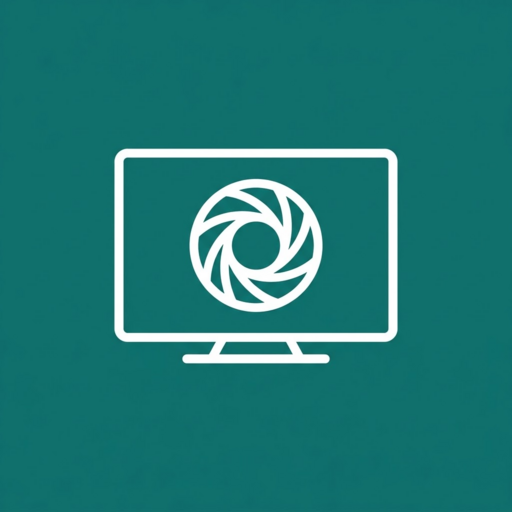

<div align="center">



# TV Ekran

**Serves an Android TV box's current screen as a JPEG over HTTP, without the screen-capture consent dialog.**

</div>

## What it does

- Runs as an accessibility service and uses `AccessibilityService.takeScreenshot` (Android 11+), so no MediaProjection prompt appears and nothing has to be confirmed on the TV.
- `GET /screen.jpg` returns a fresh frame. The platform allows one capture per second; a request inside that window gets the last frame, and a failed capture returns `503` instead of an old picture.
- `GET /health` answers `ok` for monitoring.
- The accessibility service description is English, with a Turkish translation for Turkish-language devices.
- Starts again by itself after a reboot once the service is enabled.

## Security

The HTTP server on port 8085 has no authentication: anyone on the same network can see the screen. Install it only on a trusted home network and never forward the port to the internet.

## Build

Requirements: JDK 11+, Android SDK with `build-tools` and one `platforms/android-*` (`ANDROID_SDK`, default `~/android-sdk`). No Gradle.

```bash
cp signing.env.example signing.env   # point it at your keystore; the file is git-ignored
./build.sh                           # build/TvEkran.apk
```

## Install

```bash
adb install -r build/TvEkran.apk
```

Enable **TV Ekran** in Settings → Device Preferences → Accessibility, then open `http://<box-address>:8085/screen.jpg`. Updating the APK over the old one keeps the accessibility permission.

## Layout

```
AndroidManifest.xml                 accessibility service, minSdk 30
src/dev/hakan/tvekran/
  ScreenService.java                screenshot capture + minimal HTTP server
res/                                icons, TV banner, service config and description
build.sh                            aapt2 + javac + d8 + apksigner, no Gradle
```

## License

MIT, see [LICENSE](LICENSE).
